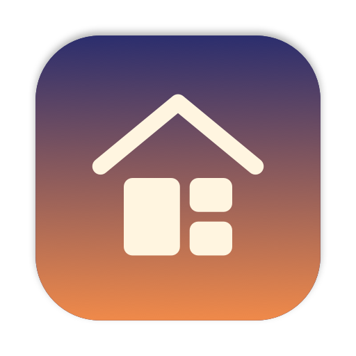
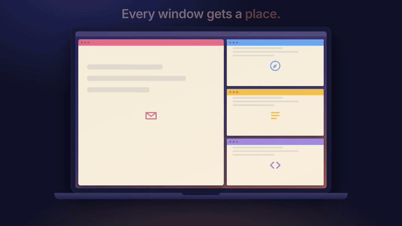
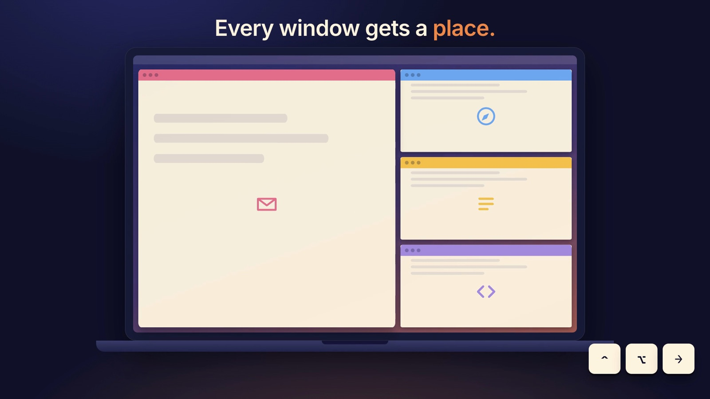
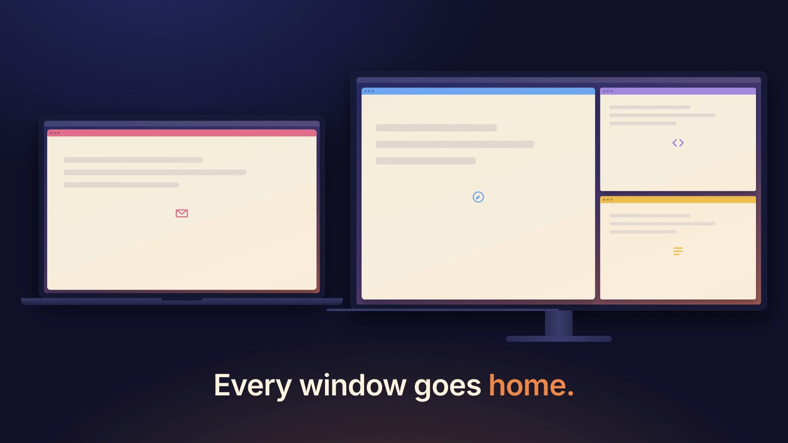
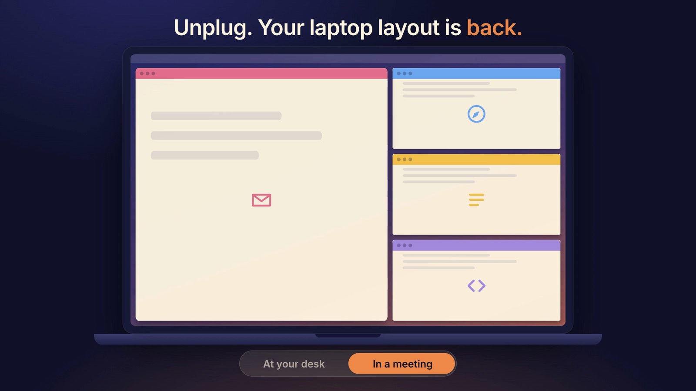
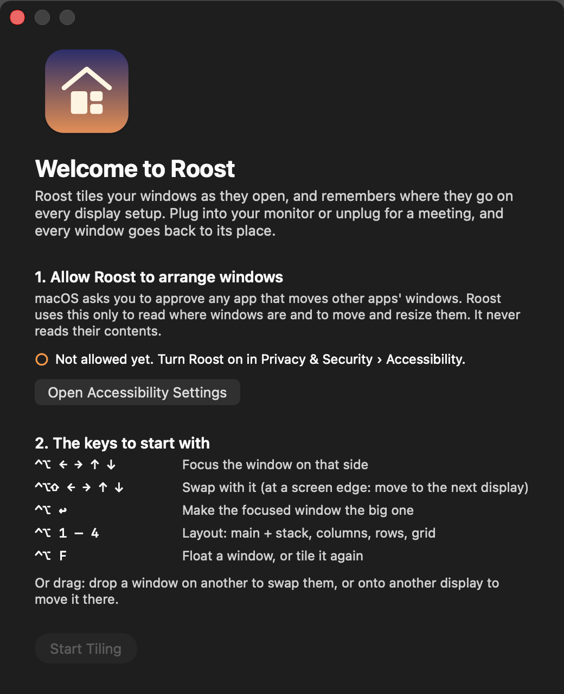

<p align="center"></p>

<h1 align="center">Roost</h1>

<p align="center"><b>Unplug your Mac. Plug back in. Every window goes home.</b><br>
A free, open-source window tiler for macOS that remembers where everything goes, on every display setup.</p>

<p align="center">
  <a href="https://github.com/PriyanshMathur1/roost/releases/latest"></a>
  <a href="https://github.com/PriyanshMathur1/roost/releases"></a>
  
  
  <a href="LICENSE"></a>
</p>

<p align="center">
  <a href="https://github.com/PriyanshMathur1/roost/releases/latest/download/Roost.zip"><b>⬇ Download for macOS</b></a>
  &nbsp;·&nbsp;
  <a href="https://github.com/PriyanshMathur1/roost/releases/download/v0.2.0/Roost-launch-video.mp4"><b>▶ Watch the 30-second video</b></a>
</p>

<p align="center"></p>

---

## The problem

You unplug your laptop for a meeting and every window lands in a heap. You come back, plug into
your monitor, and spend the next minute dragging things back where they were. Every day.

**Roost fixes that.** It tiles your windows as they open (no dragging, no config files), and it
remembers the arrangement for every combination of displays. Plug in: everything goes back to the
monitor. Unplug: your laptop layout returns. It survives restarts too.

<table>
  <tr>
    <td width="33%"></td>
    <td width="33%"></td>
    <td width="33%"></td>
  </tr>
  <tr>
    <td align="center"><b>Tiles as windows open</b></td>
    <td align="center"><b>Plug in: windows go home</b></td>
    <td align="center"><b>Unplug: laptop layout returns</b></td>
  </tr>
</table>

<sub>Illustrations from the launch video.</sub>

## What it does

- **Tiles automatically.** A new window gets a place; close one and the rest fill the gap.
- **Desk ↔ meeting memory.** Remembers the arrangement for each set of connected displays and
  restores it when that set comes back, even after a restart.
- **Works with stubborn windows.** Some windows won't shrink (Chrome below 500 pt, System
  Settings below 723 pt). Roost notices, gives them the room, and remembers per app. If not
  everything fits, the windows that need the most room float instead of everything getting
  squeezed.
- **Never makes slivers.** No tile goes below a sensible size (300 pt by default; adjustable).
- **Never piles windows on top of each other.** When more windows are open than fit, the extras
  wait neatly behind a tile. Bring one forward (Dock, ⌘-Tab or ⌃⌥Tab) and it shows in that tile.
- **Drag to rearrange.** Drop a window on another to swap them, or on another display to move it
  there. **Drag a tile's edge** to resize it, and the other tiles make room.
- **Keeps your place across Spaces.** Windows on another Space, minimised, or in a hidden app keep
  their tile; when they come back, they return to it instead of the end of the line.
- **Keyboard-first when you want it.** Focus, swap, resize and change layout with ⌃⌥ shortcuts.
- **Four layouts per display:** main + stack, columns, rows, grid. Portrait displays get rows.
- **Leaves alone what it should:** dialogs, sheets, panels, full-screen apps and minimised windows.
- **Private.** Roost makes no network connections. Its only permission is Accessibility, used to
  read where windows are and move them.

<p align="center"><br>
<sub>The first-run window walks you through the one permission Roost needs.</sub></p>

## Install

Roost is free and open source, and isn't notarised by Apple (that needs a paid developer
account). So macOS asks you to confirm the first launch:

1. Download **Roost-x.y.z.zip** from [Releases](../../releases/latest), unzip it, and move
   **Roost.app** to **Applications**.
2. Open Roost. macOS says it can't verify the developer. Click **Done**.
3. Open **System Settings › Privacy & Security**, scroll down, and click **Open Anyway** next to
   the Roost message. Confirm with **Open Anyway**.
4. Roost's welcome window opens. Click **Open Accessibility Settings** and turn **Roost** on.
   Then click **Start Tiling**.

Roost lives in the menu bar (a roof over three tiles). It runs on macOS 14 Sonoma or later, on
Apple Silicon and Intel.

### Build from source

Needs the Swift 6 toolchain (the Xcode Command Line Tools are enough).

```bash
git clone https://github.com/PriyanshMathur1/roost.git
cd roost
./scripts/bundle.sh            # builds ~/Applications/Roost.app
open ~/Applications/Roost.app
```

Apps you build yourself aren't quarantined, so there's no Gatekeeper step. See
[Signing](#signing) to keep the Accessibility permission across rebuilds.

## Shortcuts

| Keys | Action |
|---|---|
| ⌃⌥ ← → ↑ ↓ | Focus the window on that side (at a screen edge: the next display) |
| ⌃⌥⇧ ← → ↑ ↓ | Swap with the window on that side (at a screen edge: move to the next display) |
| ⌃⌥ ↩ | Make the focused window the main one |
| ⌃⌥ = / ⌃⌥ - | Grow / shrink the focused window |
| ⌃⌥ 1 – 4 | Layout: main + stack, columns, rows, grid |
| ⌃⌥ F | Float the focused window (or tile it again) |
| ⌃⌥ ⇥ | Show the next window waiting behind this tile |
| ⌃⌥ T | Tiling on / off |

Shortcuts another app already owns are listed as "taken" in the menu under **Keyboard Shortcuts**.

## Menu

Tiling on/off · layout for the display under the pointer · gap · narrowest tile · re-tile ·
reset sizes · forget learned window sizes · keyboard shortcuts · open at login · getting started.

## How it works

- **`RoostCore`** is pure Swift with no AppKit: layouts, minimum-size fitting, neighbour search,
  tile state and the display-setup memory. It has ~43,000 checks
  (`swift run RoostCoreTests`).
- **`Roost`** is the app: it watches apps with the Accessibility API (`AXObserver`), re-reads the
  windows on screen after each change (so a missed event can't leave things wrong), and moves
  windows with `AXUIElementSetAttributeValue`. Shortcuts use Carbon's `RegisterEventHotKey`,
  which needs no extra permission.

More in [docs/SPEC.md](docs/SPEC.md).

## Signing

`scripts/bundle.sh` signs with a code-signing certificate named **Roost Dev** if your login
keychain has one. macOS then ties the Accessibility permission to that certificate and the bundle
ID, so **you grant it once and rebuilds keep it**. Without one, the app is signed ad-hoc and each
rebuild needs the permission again.

To create the certificate (self-signed, valid 10 years, usable only by `codesign`):

```bash
cat > /tmp/roost-cert.cfg <<'CFG'
[req]
distinguished_name = dn
x509_extensions = ext
prompt = no
[dn]
CN = Roost Dev
[ext]
basicConstraints = critical,CA:false
keyUsage = critical,digitalSignature
extendedKeyUsage = critical,codeSigning
CFG
cd "$(mktemp -d)" && P=$(openssl rand -hex 12)
openssl req -x509 -newkey rsa:2048 -nodes -keyout key.pem -out cert.pem -days 3650 -config /tmp/roost-cert.cfg
openssl pkcs12 -export -inkey key.pem -in cert.pem -name "Roost Dev" -out id.p12 -passout pass:$P
security import id.p12 -k ~/Library/Keychains/login.keychain-db -P "$P" -T /usr/bin/codesign
rm key.pem id.p12
```

`security find-identity -p codesigning` lists it as `CSSMERR_TP_NOT_TRUSTED`; that's normal for a
self-signed certificate and doesn't stop signing. If a permission ever goes stale, run
`tccutil reset Accessibility com.priyansh.roost` and allow Roost again.

The app is built into `~/Applications` rather than the project folder because iCloud Drive (a
synced Desktop or Documents folder) adds file attributes that break code signatures.

## Known limits

- In the grid layout tiles have no individual sizes, so dragging an edge there snaps back.
- A window too big for every tile (rare) is centred on its display at its minimum size.

## FAQ

**Is it safe?** Roost is open source (MIT), so every line is here to read. It makes no network
connections and only asks for Accessibility, which macOS requires for any app that moves other
apps' windows. It never reads window contents.

**Why does macOS say it can't verify the developer?** Apple notarisation needs a paid developer
account. Roost is free and isn't notarised yet, so the first launch needs **Open Anyway** in
System Settings › Privacy & Security. You can also [build it yourself](#build-from-source).

**How is it different from other window managers?** Roost is built around one job: remembering
where your windows go for each combination of displays, with no setup. Open it, allow
Accessibility, and it works: no config files, layouts or rules to write.

**Does it slow my Mac down?** It sleeps until a window opens, closes or moves, then re-checks
once. There's no polling loop.

## Roadmap

- Saved setups: name an arrangement ("Deep work", "Standup") and switch with one shortcut
- Per-app rules (always float, always on a given display)
- Automatic updates
- Homebrew cask (`brew install --cask roost`)

Ideas and bug reports are welcome in [Issues](https://github.com/PriyanshMathur1/roost/issues).

## Like it?

⭐ **Star the repo** so others find it, and [share it on X](https://twitter.com/intent/tweet?text=Roost%3A+a+free%2C+open-source+window+tiler+for+macOS.+Unplug+for+a+meeting%2C+plug+back+in%2C+and+every+window+goes+back+to+its+place.&url=https%3A%2F%2Fgithub.com%2FPriyanshMathur1%2Froost).

## Contributing

Issues and pull requests are welcome. Please run `swift run RoostCoreTests` before sending a
change, and add checks for any new layout logic.

### Testing on a real Mac

`scripts/repro/` has end-to-end checks that drive the running app and exit non-zero on failure:
native tabs, extra windows stacking, tile order staying stable, minimise/restore, drag-and-drop,
windows keeping their place while away, and resizing a tile by its edge.
They read a state dump that Roost writes only when asked:

```bash
defaults write com.priyansh.roost debugState -bool true   # writes ~/Library/Logs/Roost/state.json
swiftc -O scripts/repro/roostctl.swift -o /tmp/roostctl  # sends debug commands (minimise, drop, …)
ROOSTCTL=/tmp/roostctl ./scripts/repro/drag-drop.sh
```

The same state dump is the most useful thing to attach to a bug report.

## License

[MIT](LICENSE) © 2026 Priyansh Mathur

The launch video's music is *Talent in the Air* from [Mixkit](https://mixkit.co/free-stock-music/).
